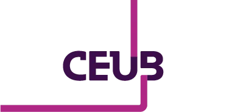
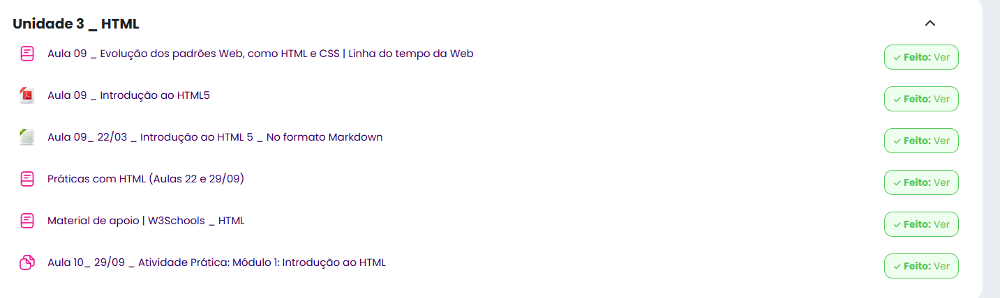
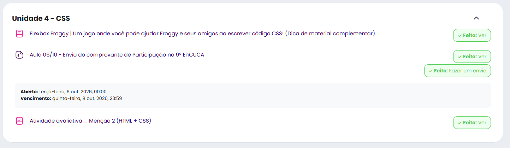
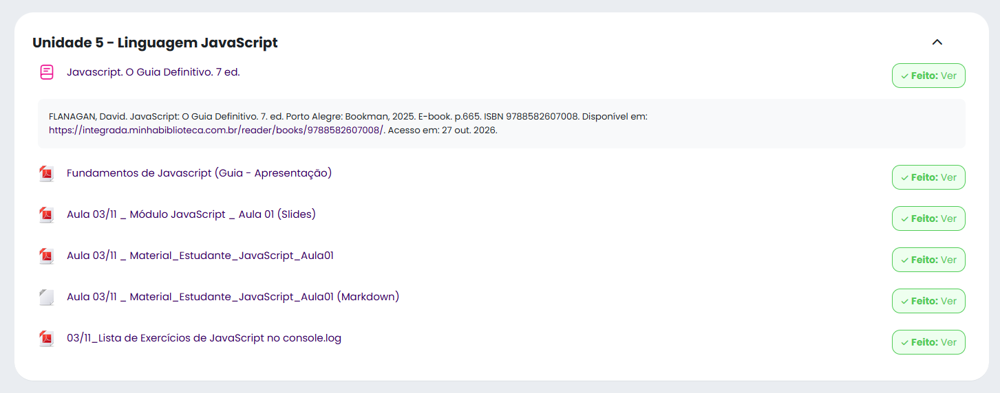
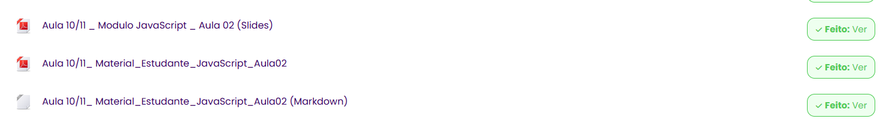
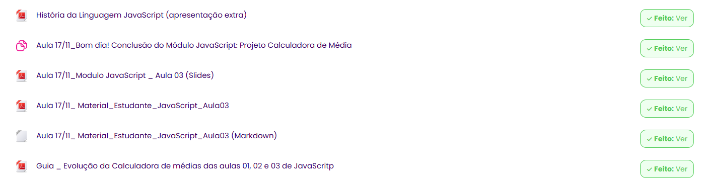
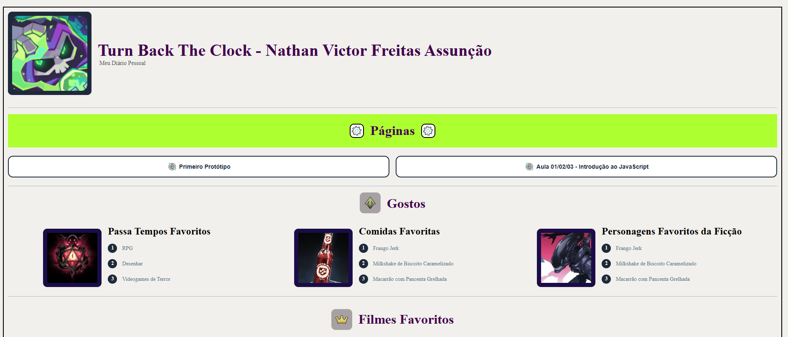
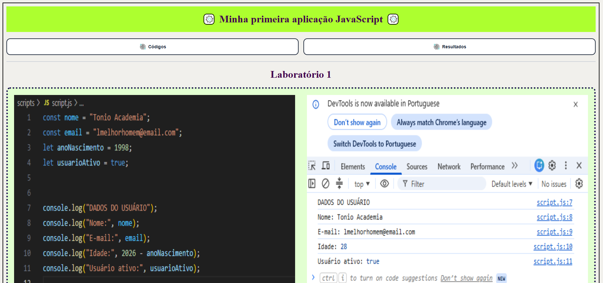

# 🍣 Desenvolvimento JavaScript 🍣                                                                                                                                                 </img>

> [!IMPORTANT]
> ### Referênciamento a Menção 2: https://docs.google.com/document/d/13P-JP0QKZs-dSaAzC7d56VLucEaJWut_c-fvA99y5Dk/edit?tab=t.0

***
</img>

> [!NOTE]
> **Site para Aula 27/10/2026 para a Avaliação 2**\
> **Esse site é feito como um tipo de cartão de apresentação sobre mim**\
> **O Único uso de IA que teve foi para tirar dúvidas sobre CSS**

***

# 🥞 Progresso Documentado 🥞

| DATA | Atividade | Descrição | Print |
|---|-----------|-----------|------|
| 20/10/26 | Prototipagem HTML Site | Aula focada na ferramenta Visual Studio Code e HTML5 para a criaçã do nosso Primeito Site |  |
| 27/10/26 | Criação do Portfólio Pessoal | Criação de Site para upload no Github Pages com foco no aprendizado e prática em HTML5 e CSS |  |
| 03/11/26 | Aprendizagem de JS e Update de ReadMe | Aula focada na correlação entre JavaScript e HTML e como podemos utiliza-lo para aprofundarmos nossos sites |  |
| 10/11/26 | Aplicação JavaScript | Aula prática sobre a aplicação de javascript em nossos arquivos HTMLs |  |
| 17/11/26 | Evolução e Revisão JavaScript | Aula especializada e Revisionada sobre como podemos melhorar nosso entendimento de JavaScript e seus diferentes usos |  |

## 📁 Estrutura do Repositório

- `index.html`: HUB Principal do projeto.
- `aula01-javascript.html`: Contém os arquivos os laboratórios feitos durante o desenvolvimento do projeto.
- `imgs/`: Contém os arquivos de imagem/gif usados durante o desenvolvimento do projeto.

### HUB

</img>

### Laboratório

</img>

### GitHub Stats

### Let's Connect

   

## 📜 Licença

Este projeto está sob a licença **MIT**. Veja o arquivo [LICENSE](./LICENSE) para mais detalhes.
