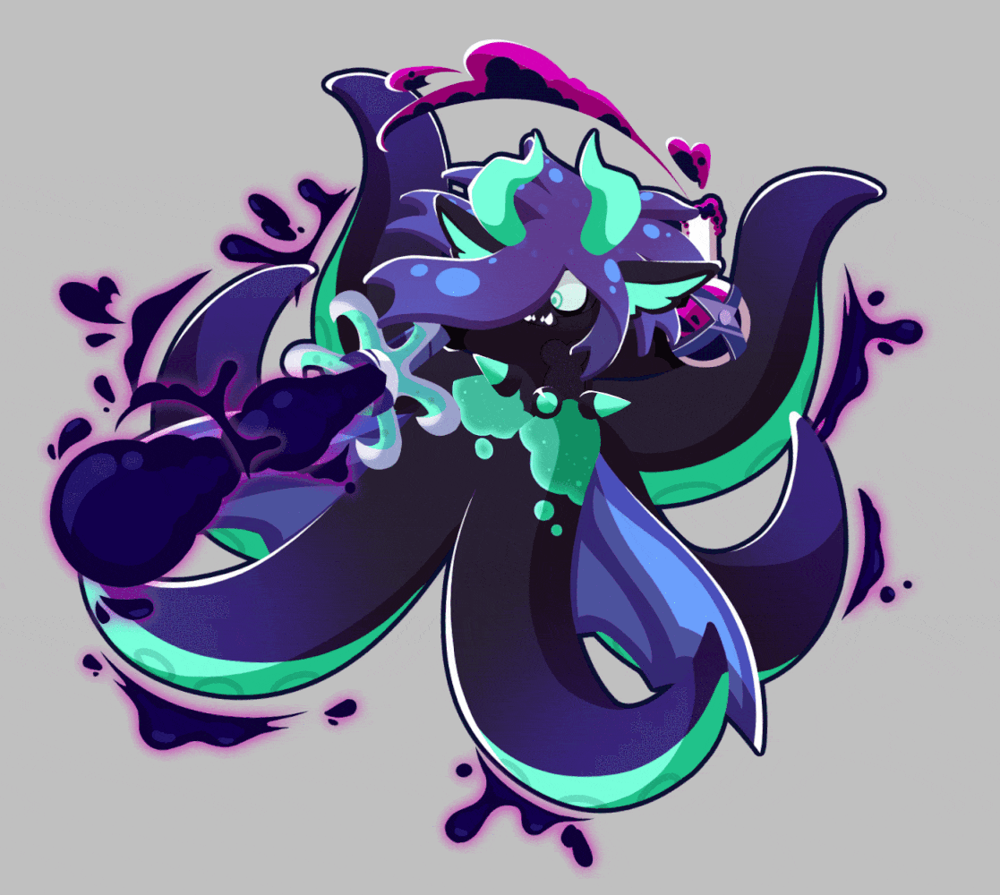

# 🍣 Meu_Primeiro_Site 🍣

> ## Referênciamento a Menção 2: https://docs.google.com/document/d/13P-JP0QKZs-dSaAzC7d56VLucEaJWut_c-fvA99y5Dk/edit?tab=t.0

***
</img>

```
> Site para Aula 27/10/2026 para a Avaliação 2 
> Esse site é feito como um tipo de cartão de apresentação sobre mim 
> O Único uso de IA que teve foi para tirar dúvidas sobre CSS
```

***

# 🥞 Progresso Documentado 🥞

| DATA | Atividade | Descrição | Print |
|---|-----------|-----------|------|
| 20/10/26 | Prototipagem HTML Site | Aula focada na ferramente Visual Studio Code e HTML5 para a criaçã do nosso Primeito Site |  |
| 27/10/26 | Criação do Portfólio Pessoal | Criação de Site para upload no Github Pages com foco no aprendizado e prática em HTML5 e CSS |  |

## 📁 Estrutura do Repositório

- `imgs/`: Contém os arquivos de imagem/gif usados durante o desenvolvimento do projeto.

---

## 📜 Licença

Este projeto está sob a licença **MIT**. Veja o arquivo [LICENSE](./LICENSE) para mais detalhes.
